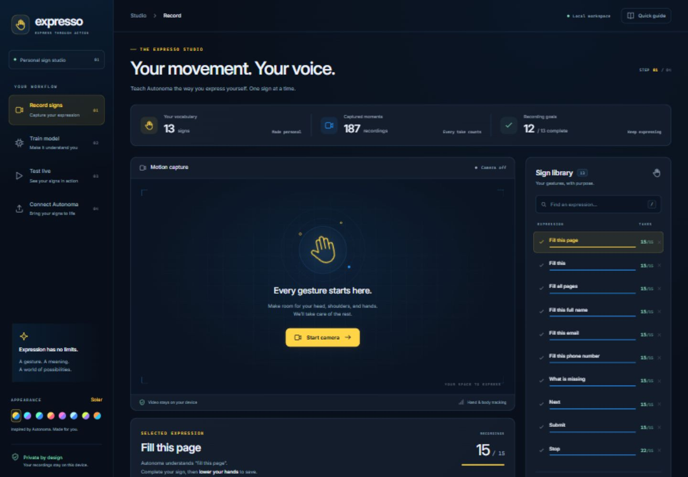
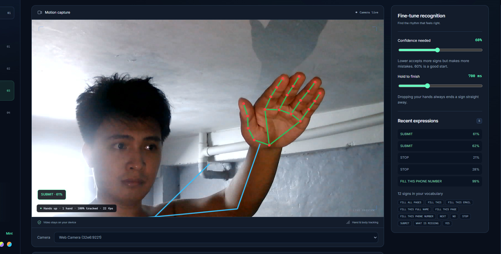

# Expresso: express through action

Expresso is where you **teach Autonoma your signs**. You record your own signs (shoulders, arms and hands, like FSL) with your webcam. Expresso trains a small model on this computer, and you then send that model to Autonoma, which only *recognises* signs while it fills forms.

Training stays here so the extension stays light: Autonoma never trains and never loads PyTorch. Nothing leaves your computer, and no cloud services or API keys are involved.

> **Judges: Expresso is one half of a two-repo project.**
> - **[Autonoma](https://github.com/Jullemyth122/Autonoma)** is the Chrome extension that fills forms by click, voice or sign. Its README has the full setup, and its [SUBMISSION.md](https://github.com/Jullemyth122/Autonoma/blob/main/SUBMISSION.md) answers the submission questions.
> - **Expresso** (this repo) is where signs are recorded and trained. Clone both **side by side** (`Hackathon/Autonoma` and `Hackathon/Expresso`): Export copies the model into `../Autonoma/public/sign`.
> - 📖 **[Sign guide](docs/SIGNS.md)**: what each of our 12 signs looks like (animated, drawn from our recordings), and how to sign for Autonoma.
> - You don't need Expresso to try Autonoma's click and voice features. You need it only for Sign mode, and then you train your own signs (a model learns the person who recorded it).





*Test tab, live: the skeleton is MediaPipe's tracking (22 fps on the laptop); the list on the right is what Autonoma would hear.*

```
 Expresso (this app, 127.0.0.1:5180)                      Autonoma (Chrome extension)
 ┌──────────┐   ┌─────────┐   ┌────────┐   ┌──────────┐     ┌──────────────────────────────┐
 │ 1 Record │ → │ 2 Train │ → │ 3 Test │ → │ 4 Export │ ──► │ public/sign/fsl.onnx + labels │
 └──────────┘   └─────────┘   └────────┘   └──────────┘     │ Sign mode → same commands as  │
  webcam →       PyTorch on     live, same    copies the     │ voice ("FILL THIS PAGE" → fill)│
  landmarks      your CPU       as Autonoma   model over     └──────────────────────────────┘
```

## Setup (once)

You need Node 20+ and Python 3.11 (`py -3.11` on Windows).

```powershell
# Clone both repos side by side (Export writes into ../Autonoma/public/sign)
mkdir C:\Hackathon; cd C:\Hackathon
git clone https://github.com/Jullemyth122/Autonoma.git
git clone https://github.com/Jullemyth122/Expresso.git

cd C:\Hackathon\Expresso
npm install
npm run setup:ml      # makes ml/venv with CPU PyTorch (~1 GB download)
npm run dev           # opens on http://127.0.0.1:5180
```

Your recordings (`data/samples/`) and trained model (`ml/out/`) are not in git. If you saved a copy, put the `.json` files back into `data/samples/` and press **Train my model** to rebuild the model; otherwise start recording from step 1.

## How to use it

1. **Record**
   - Type your name, pick a sign on the right, press **Record sign** (or **Space**).
   - Raise your hands, do the sign, then **drop your hands**: that saves one recording.
   - Do about 15 per sign, varying speed and position a little.
   - Record **`_none`** too (25 or more random movements: scratching, waving, reaching for the mouse). It's what stops Autonoma from mistaking ordinary movement for a command.
2. **Train**
   - Press **Train my model**. It takes about a minute for a dozen signs.
   - Every 5th recording of each sign is held out to measure accuracy, so you see per-sign accuracy and which signs get mixed up.
3. **Test**
   - Sign live and watch what *Autonoma hears*.
   - The confidence slider (60% by default) and the hold-still time are the same settings Autonoma uses.
4. **Export**
   - Copies `fsl.onnx`, `labels.json`, `report.json` and `selftest.json` into `../Autonoma/public/sign`, and can rebuild Autonoma for you.
   - Then reload the extension in `chrome://extensions`.

### Adding, removing and renaming signs
- **Add** with the box under the list (for example `FILL THIS BIRTHDAY`).
- **Remove** with ×. Recordings stay on disk, so adding the sign again brings them back.
- **To rename**, add the new name and record it. (Recordings are stored per name in `data/samples/<NAME>.json`.)

### Naming signs
Autonoma reads a sign's name exactly as if you had **said** it, then runs it through the same command rules as voice. So name signs like spoken commands:

| Sign | Autonoma does |
|---|---|
| `FILL THIS PAGE`, `FILL ALL PAGES` | fills the page or every page |
| `FILL THIS` | fills the question you're on |
| `FILL THIS FULL NAME`, `FILL THIS EMAIL`, `FILL THIS PHONE NUMBER`… | fills just that field |
| `WHAT IS MISSING` | lists the questions still empty |
| `NEXT`, `STOP` | next page; stop |
| `SUBMIT` | asks for `YES` first, so it never submits by accident |
| `_none` | ignored |

## What's inside

| Path | What it is |
|---|---|
| `src/pages/` | Record, Train, Test and Export tabs (React + Vite) |
| `src/lib/` | MediaPipe hand and pose tracking, 142 numbers per frame (`features.ts`), sign cutting (`segmenter.ts`), ONNX classifier |
| `server/api.ts` | local API inside the Vite dev server: saves recordings, runs training, serves the model, exports to Autonoma |
| `ml/train.py` | trainer (1D CNN over 32 resampled frames → `ml/out/fsl.onnx`) |
| `ml/render_signs.py` | draws every recorded sign as an animated stick figure + strip into `docs/signs/`, and writes the [sign guide](docs/SIGNS.md) |
| `ml/features.py` | Python copy of the features, so training and the browser compute identical numbers |
| `data/samples/` | your recordings (git-ignored: they are your body movements) |

**Checks:**
```powershell
npm run typecheck
ml\venv\Scripts\python ml\make_test_vectors.py; npm run match-test   # Python and TS features must match
```

**Safety:**
- The API only answers on `localhost` and `127.0.0.1`.
- Every write needs an `x-expresso: 1` header, so other websites can't trigger recording or training through your browser.
- Don't expose port 5180 to a network: it writes files and starts processes.

## Known limits

- **It learns one person.** A model trained only on you will work worse for other signers or other lighting. Add recordings from others with their own name for better generalisation.
- **Signs must start and end with hands up then down,** or with a short hold. Signs mostly below the chest are treated as "hands down" and ignored.
- **Left and right hands are sorted by screen position,** so crossing your hands mid-sign can confuse it.
- **The held-out accuracy is optimistic.** It uses your own recordings from the same session.
- **Phrases are whole signs.** `FILL THIS PHONE NUMBER` is learnt as one movement, not three words.

## Disclosure

- **Models:**
  - Google MediaPipe hand and pose landmarkers, pretrained, used as published.
  - Your sign classifier, a small 1D CNN trained **only on your own recordings** on your CPU. No dataset ships with Expresso.
- **Technologies:** React 19, TypeScript, Vite 8, MediaPipe Tasks Vision 1.1.0, ONNX Runtime Web, PyTorch 2.14 (CPU), NumPy, ONNX.
- **APIs and cloud services:** none. Nothing is sent anywhere. Internet is needed only for `npm install` and `npm run setup:ml` (PyTorch download).
- **Existing code and assets:**
  - The feature pipeline, segmenter, MediaPipe setup and match test were adapted from the team's earlier FSL project, Kamay.
  - The MediaPipe models are Google's.
  - The Inter font is under the SIL OFL 1.1 (`public/fonts/Inter-LICENSE.txt`).
- **AI development tools:**
  - **Claude Code** built the app, API, trainer and tests.
  - **ChatGPT Codex** redesigned the UI (app shell, themes, icons, page layouts).
  - See [TIMELOG.md](TIMELOG.md) for who did what, and when.

## Credits

- The feature pipeline and model design come from the **Kamay** FSL project, which used **FSL-105**: Tupal, I. J. & Cabatuan, M. K., *FSL-105: Filipino Sign Language dataset*, Mendeley Data V2, doi:10.17632/48y2y99mb9.2, CC BY 4.0. Expresso doesn't ship or train on FSL-105; it trains only on your recordings.
- Hand and pose tracking: Google MediaPipe Tasks (Apache 2.0). Inference: ONNX Runtime Web (MIT).

