# Sign guide: the 12 signs we trained

These are the signs recorded in Expresso for Autonoma's commands, one section per sign. Each sign is drawn from our own recordings, from the take the trained model recognises most surely. Only the tracked points are drawn (no video).

**How to read the pictures**
- The figure is **mirrored, like the camera preview**: move the way you see it.
- **Green = your right hand, amber = your left hand.** Arms are faint (the camera often can't see your elbows).
- The **dashed line** is chest height. Hands below it count as *down*, so a sign happens above it.
- The animation loops the whole sign. The strip shows six moments, left to right. The last panel shows the path each wrist travels: ○ start, ● end.

**How to sign for Autonoma**
1. Sit so your head, shoulders and both hands are in view, in good light.
2. Start with your hands **down**.
3. Raise them, make the sign, then **drop your hands**. Dropping your hands ends the sign; holding still for 0.7 s also works.
4. One sign at a time. The orb shows *Reading your sign…*, then *Signed "…"*, or *Not sure… sign it again*.

**Trying it yourself (judges)**
- Our trained model is **not** in the repository. It's learnt from one person's body and wouldn't read you reliably, and it stays private.
- Copy these movements in **Expresso**:
  1. **Record:** 15 takes of each sign, plus 25 random movements as `_none`.
  2. **Train**, then **Test** it live.
  3. **Export** to Autonoma.
- In **[Autonoma](https://github.com/Jullemyth122/Autonoma)**:
  1. Reload the extension.
  2. Workspace → **Signs** → **Allow camera** and **Run self-test**.
  3. Switch on **Sign mode** in the side panel.
- You can also make up your own signs: any name that reads like a command works (e.g. `FILL THIS BIRTHDAY`).

| Sign | What Autonoma does |
| --- | --- |
| [FILL THIS PAGE](#fill-this-page) | Fills the whole page. |
| [FILL THIS](#fill-this) | Fills the question you last clicked, or the one in the middle of the screen. |
| [FILL ALL PAGES](#fill-all-pages) | Fills the form and clicks Next through every page. |
| [FILL THIS FULL NAME](#fill-this-full-name) | Fills only the full-name question. |
| [FILL THIS EMAIL](#fill-this-email) | Fills only the email question. |
| [FILL THIS PHONE NUMBER](#fill-this-phone-number) | Fills only the phone-number question. |
| [WHAT IS MISSING](#what-is-missing) | Says (and shows) which questions are still empty. |
| [NEXT](#next) | Clicks Next. |
| [SUBMIT](#submit) | Asks first: it submits only after a YES sign within 15 seconds. |
| [YES](#yes) | Confirms a SUBMIT. |
| [NO](#no) | Cancels a SUBMIT. |
| [STOP](#stop) | Stops a fill. Always goes through, even while another command runs. |

---

### FILL THIS PAGE

**Autonoma:** Fills the whole page.


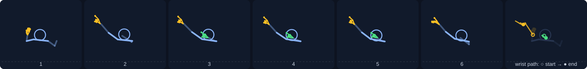

Hands: right and left · 15 takes recorded · a typical take is about 77 frames (≈ 3.9 s). The trained model recognises this take 72% surely.

### FILL THIS

**Autonoma:** Fills the question you last clicked, or the one in the middle of the screen.


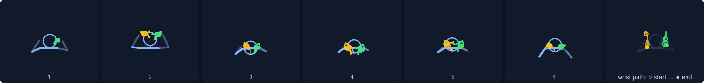

Hands: right and left · 15 takes recorded · a typical take is about 52 frames (≈ 2.6 s). The trained model recognises this take 84% surely.

### FILL ALL PAGES

**Autonoma:** Fills the form and clicks Next through every page.


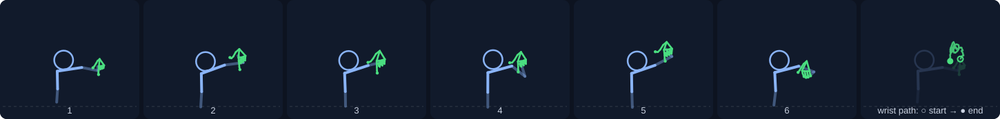

Hands: right · 15 takes recorded · a typical take is about 71 frames (≈ 3.5 s). The trained model recognises this take 90% surely.

### FILL THIS FULL NAME

**Autonoma:** Fills only the full-name question.


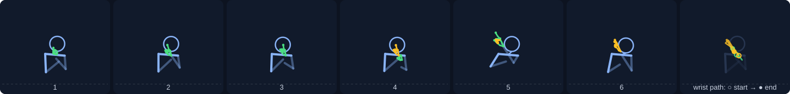

Hands: right · 15 takes recorded · a typical take is about 60 frames (≈ 3.0 s). The trained model recognises this take 83% surely.

### FILL THIS EMAIL

**Autonoma:** Fills only the email question.


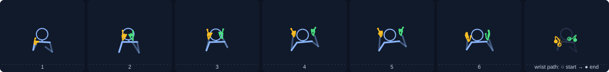

Hands: right and left · 15 takes recorded · a typical take is about 59 frames (≈ 3.0 s). The trained model recognises this take 87% surely.

### FILL THIS PHONE NUMBER

**Autonoma:** Fills only the phone-number question.


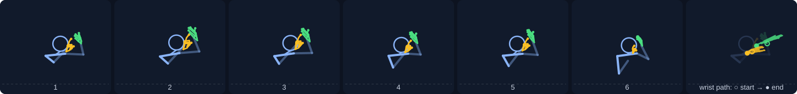

Hands: right and left · 15 takes recorded · a typical take is about 84 frames (≈ 4.2 s). The trained model recognises this take 87% surely.

### WHAT IS MISSING

**Autonoma:** Says (and shows) which questions are still empty.


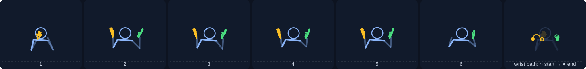

Hands: right and left · 15 takes recorded · a typical take is about 49 frames (≈ 2.5 s). The trained model recognises this take 87% surely.

### NEXT

**Autonoma:** Clicks Next.


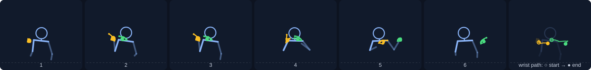

Hands: right and left · 15 takes recorded · a typical take is about 61 frames (≈ 3.0 s). The trained model recognises this take 91% surely.

### SUBMIT

**Autonoma:** Asks first: it submits only after a YES sign within 15 seconds.


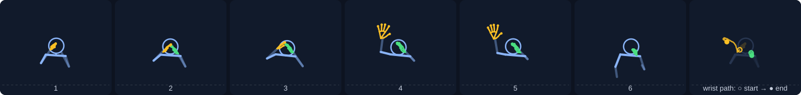

Hands: right and left · 15 takes recorded · a typical take is about 45 frames (≈ 2.2 s). The trained model recognises this take 91% surely.

### YES

**Autonoma:** Confirms a SUBMIT.


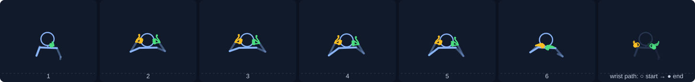

Hands: right and left · 15 takes recorded · a typical take is about 54 frames (≈ 2.7 s). The trained model recognises this take 88% surely.

### NO

**Autonoma:** Cancels a SUBMIT.


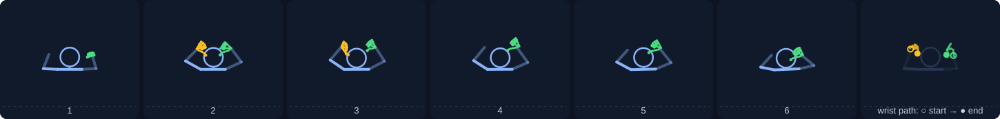

Hands: right and left · 15 takes recorded · a typical take is about 47 frames (≈ 2.4 s). The trained model recognises this take 88% surely.

### STOP

**Autonoma:** Stops a fill. Always goes through, even while another command runs.


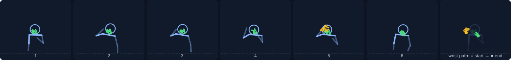

Hands: right and left · 22 takes recorded · a typical take is about 59 frames (≈ 3.0 s). The trained model recognises this take 89% surely.

---

*Made by `ml/render_signs.py` from the recordings in `data/samples/` (re-run it after recording or training again).*
